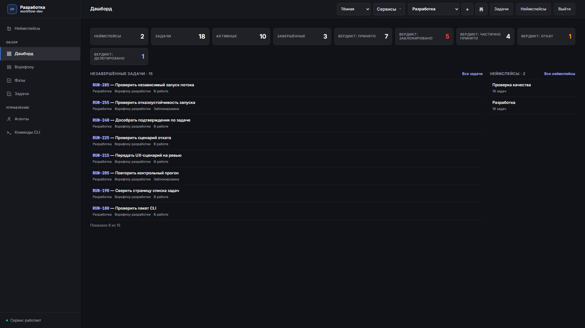
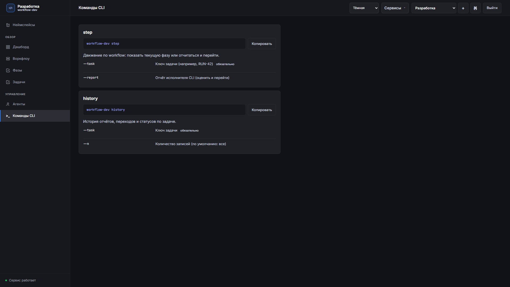
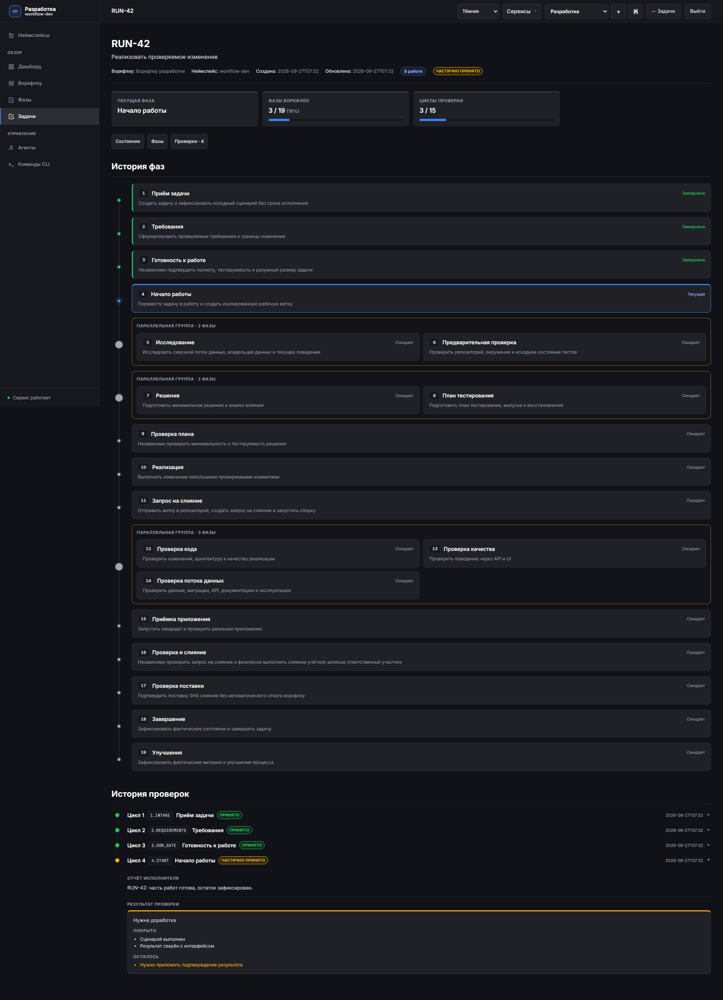
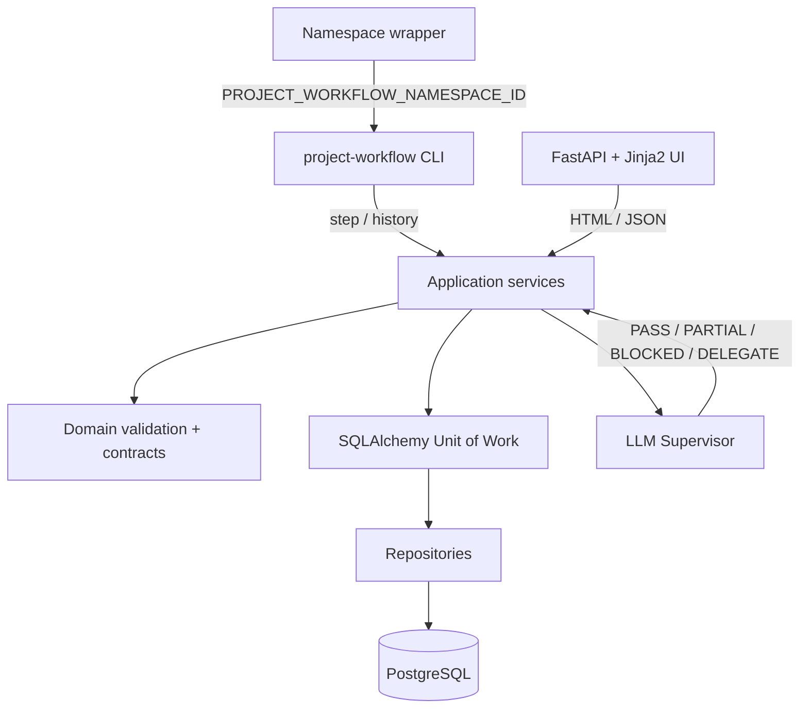

# Project Workflow

<p align="center">
  
</p>

<p align="center">
  <a href="#overview"></a>
  <a href="#capabilities"></a>
  <a href="#entrypoints"></a>
  <a href="#quick-start"></a>
  <a href="#ui"></a>
  <a href="#visual-proof"></a>
  <a href="#architecture"></a>
  <a href="#quality"></a>
</p>

<p align="center">
  
  
  
  
  
  
  
  
</p>

---

## 🎯 Позиционирование

Действующий путь для всех профессий: [единый CLI/API](docs/configured-cli-v1.md).
Установка и живой прогон учитываются отдельно от source-проверок.

**project-workflow** — внутренняя private-платформа для пофазного ведения задач. Агент отчитывается через CLI, обязательный LLM Supervisor проверяет отчёт и выдаёт вердикт: **PASS**, **PARTIAL**, **BLOCKED** или **DELEGATE**.

Web UI управляет профессиями, их воркфлоу и фазами, показывает историю выполнения.
Обычный CLI содержит только `step` и `history`: агент получает инструкцию, выполняет
работу и отправляет фактический отчёт для оценки advisor. CLI работает через API.
В platform он использует назначение Tracker и identity Auth; задача создаётся
при принятии назначения. В standalone локальный запуск явно создаётся через
`step --start`. Обычное чтение `step` задачу не создаёт в обоих режимах.

Ручная проверка качества: [регламент](LIVE_TEST_PLAN.md) и
[файловая песочница через CLI](manual/file-sandbox/README.md). Прямой запуск
движка не является доказательством прохождения этого пути.

### Исторические Данные

Прежние native-протоколы, build-профили и способы adoption не являются
поддерживаемым путём исполнения. Их описание сохранено только в
[историческом документе](docs/architecture-native-history.md) и Git-истории.
Старые задачи и отчёты не удаляются и не переоцениваются, но архив не выдаёт
новую execution authority. Действующий контракт: [CLI/API](docs/configured-cli-v1.md)
и [архитектура](docs/architecture.md). Runtime-хранилище — PostgreSQL;
SQLite используется только для изолированных тестов.

<a name="overview"></a>

## Параллельные фазы в схеме

Параллельная группа отображается одной колонкой карточек с общим заголовком
и количеством одновременных фаз. Если после неё есть следующий этап, подпись
показывает барьер: переход возможен после завершения всех фаз группы.
Этот же смысл сохраняется в компактном списке и на узком экране.

Группа — непрерывная последовательность фаз с режимом `parallel`. Последовательная
фаза завершает группу. UI, проверки каталога и Supervisor используют одно доменное
правило; скрытые связи не делят группу. Возврат задания на прежнюю фазу и вердикт
`ROLLBACK` исключены из действующего исполнения. Ошибка проверки оставляет задание
на текущем этапе с объяснением. Старые поля и события остаются только для чтения
истории. Полный контракт — [исполнение фаз](docs/phase-execution.md).

## Режимы запуска и авторизации

| Режим | Когда использовать | Настройки | Поведение |
|---|---|---|---|
| Standalone без авторизации | Собственная локальная установка, только loopback | `PROJECT_WORKFLOW_MODE=standalone` | Собственные PostgreSQL, workflow и Advisor; Auth/Fleet/Tracker не нужны. |
| Platform | Платформенная установка, без обязательной админ-консоли | `PROJECT_WORKFLOW_MODE=platform`, `AUTH_ISSUER`, `AUTH_INTERNAL_BASE_URL`, `AUTH_PUBLIC_ORIGIN`, `AUTH_SESSION_SECRET` | Auth, назначения и подтверждения обязательны; ошибка не включает standalone. |
| Personal-token CLI | CLI запускается вне БД сервиса | `SDLC_API_TOKEN`, `PROJECT_WORKFLOW_URL`, отдельно установленный `pdlc-cli-core` | Central Auth интроспектирует token и scopes `project-workflow:read/write`; token не хранится приложением. |

### Standalone без авторизации

Режим включается явно; отсутствие `AUTH_ISSUER` его не выбирает. Репозиторный
Compose и `.env.example` выбирают standalone. Создайте собственные workflow,
фазы и namespace в UI, затем настройте URL и namespace CLI один раз:

```bash
cp .env.example .env
docker compose -p sdlc-qa-workflow-local -f docker-compose.yml up --build -d --wait
curl --fail http://127.0.0.1:8812/health
```

UI: `http://127.0.0.1:8812`. API и PostgreSQL опубликованы только на loopback.
CLI использует HTTP, не открывает БД и не требует внешнего токена. Выберите
`PROJECT_WORKFLOW_MODE=standalone`, `PROJECT_WORKFLOW_URL` и
`PROJECT_WORKFLOW_NAMESPACE_ID`, затем `project-workflow --json step --task LOC-1
--start --workflow-id <id> --mode-key <key> --operation-key <stable-key>`.
Следующий step читает инструкции; report требует текущую version и отдельный key.
После локальной QA выполните down для того же Compose project и файла.

### Central Auth SSO

В `services-base` зарегистрирован OIDC client `project-workflow` с redirect URI
`http://localhost:8812/sso/callback`. Для локального общего контура API должен
быть подключён к сети `sdlc-ux_platform` через версионируемый
`services-base/deploy/project-workflow.local.override.yml`. В этом режиме
адреса, достижимые с браузера и из контейнера API, выглядят так:

```dotenv
AUTH_ISSUER=http://localhost:7701
AUTH_INTERNAL_BASE_URL=http://auth:7701
AUTH_PUBLIC_ORIGIN=http://localhost:8812
AUTH_SESSION_SECRET=[CHANGE_ME_AT_LEAST_32_CHARACTERS]
AUTH_COOKIE_SECURE=false
```

`AUTH_INTERNAL_BASE_URL` обязан быть достижим из контейнера API. Если Central
Auth опубликован только на host, сначала проверьте URL из контейнера API;
`host.docker.internal` подходит только там, где host-gateway действительно
доступен. Недоступный адрес даёт `503` на OIDC callback, а не успешный SSO.
`AUTH_ISSUER` должен точно совпадать с issuer Central Auth, а
`AUTH_PUBLIC_ORIGIN` — с зарегистрированным redirect URI. После смены
настроек общего стенда повторите
`pwsh -File services-base/deploy/start-workspace.ps1` из корня workspace:
скрипт применяет оба Compose-файла и сохраняет volumes. Для отдельного
Compose перезапускайте API с тем же набором `-f`, с которым он был поднят.

Проверка: открыть `/` → redirect на Central Auth → завершить login → callback
возвращает на исходную страницу. Без cookie `/api/*` отвечает `401`; runtime
bridge `/internal/runtime/*` не использует browser SSO и защищается только
собственными role tokens.

В центральном режиме cookie с префиксами `workflow_sso`, `workflow_oidc_state`
и `workflow_namespace_id` получают SHA-256-суффикс из настроенных публичных
`AUTH_ISSUER` и `AUTH_PUBLIC_ORIGIN`. Cookie не разделяются по портам браузером,
поэтому это сохраняет независимые входы и выбранные неймспейсы двух локальных
стендов. Внутренний адрес Auth и заголовок `Host` не меняют суффикс.
Чтение, серверная запись, JS-selector и очистка используют одно имя; cookie
SSO остаются HttpOnly, а namespace-cookie доступна selector JS. `Secure` и
`SameSite=Lax` сохраняются при записи и удалении.

После обновления старые cookie без суффикса в центральном режиме не читаются
и не удаляются: пользователь повторяет переход через Central Auth, используя
свою действующую центральную сессию. Незавершённый старый callback надо начать
заново. При изменении issuer/origin также требуется новый переход SSO.
В standalone-режиме без issuer имя namespace-cookie остаётся прежним.
Это разделение состояния, не изоляция недоверенных приложений на одном host:
для такого контура нужны отдельные домены.

## 📌 Snapshot

| Поле | Значение |
|---|---|
| Статус | Internal `1.0.0` |
| Runtime | PostgreSQL + SQLAlchemy/Alembic |
| Docker UI/API | `http://127.0.0.1:8812` |
| App/systemd port | `8811` внутри приложения |
| CLI selector | `PROJECT_WORKFLOW_NAMESPACE_ID` |
| UI selector | cookie с префиксом `workflow_namespace_id` (в SSO с суффиксом), query override `?namespace_id=` |
| License | FerrPOINT Proprietary Source-Available Evaluation License v1.0 |

<a name="capabilities"></a>

## ✨ Возможности

| Feature | Описание |
|---|---|
| Phase workflow | Задача идёт по шаблону фаз с инструкциями, checks, evidence и audit history. |
| Supervisor gate | Переход фазы проходит через обязательную оценку отчёта и фиксирует `PASS` / `PARTIAL` / `BLOCKED` / `DELEGATE`. |
| Namespace runtime | Несколько entrypoints могут иметь свои workflow, задачи, стиль UI и CLI-команду. |
| Web UI | Управление воркфлоу, фазами и профессиями; просмотр задач и audit history. |
| Append-only history | История фаз и `step`-проверок не затирается. |
| CLI freeze | Публичный CLI остаётся управляемым и предсказуемым: `step` / `history`. |
| Wrapper commands | `workflow-qa`, `workflow-dev` и другие команды генерируются из записей PostgreSQL. |
| Automatic baseline | `docker compose up` поднимает Postgres, применяет миграции и загружает versioned managed-каталог v2: 7 workflow / 11 modes с независимыми scope sets. |

## 🔧 Стек

| Zone | Tech | Роль |
|---|---|---|
| Runtime | Python 3.10+ | application runtime и packaging target |
| Data | PostgreSQL | source of truth для UI, CLI и supervisor state |
| ORM | SQLAlchemy 2 | models, repositories, unit-of-work |
| Migrations | Alembic | schema history и baseline |
| API/UI | FastAPI + Jinja2 | server-side UI и JSON endpoints |
| Validation | Pydantic | settings, schemas и DTO boundaries |
| CLI | Click + Rich | компактный agent-facing command surface |
| Tooling | uv + constraints.txt | повторяемый локальный и container dependency set |
| Quality | pytest, ruff, mypy | локальный quality gate |

<a name="entrypoints"></a>

## 🧩 CLI Entry Points

Каждый namespace/entrypoint хранит:

| Field | Role |
|---|---|
| Name и description | UI identity и human-facing purpose |
| Bound workflow | Phase template для задач этого entrypoint |
| Icon и theme color | Стилизация header, dashboard и task-detail |
| Custom CLI command | Пользовательская wrapper-команда, например `workflow-qa` |

Верхний UI selector переключает logo/name, accent color, dashboard, task list, task detail и `/phases`. Выбранный entrypoint хранится в cookie с префиксом `workflow_namespace_id` (в SSO с суффиксом issuer/origin); `?namespace_id=` имеет приоритет над cookie.

Канонический API: `/api/namespaces`; старые UI/API alias-роуты не входят в публичную поверхность.

## 🖥️ CLI

`project-workflow step/history` используют только HTTP-контракт
`configured-cli-v1` и установленный пакет `pdlc-cli-core` из Base.
`DATABASE_URL` нужен серверу и миграциям, но не CLI; локального DB fallback нет.
Оператор один раз настраивает CLI под режим сервера, namespace и исполнителя,
а не устанавливает пакеты или передаёт credentials заново для каждого отчёта.

Standalone полностью работает без Auth, Fleet и Tracker, только через loopback:

```bash
export PROJECT_WORKFLOW_MODE=standalone
export PROJECT_WORKFLOW_URL=http://127.0.0.1:8812
export PROJECT_WORKFLOW_NAMESPACE_ID='<namespace ID из UI/API>'
```

Platform использует отдельный PAT с правами Workflow и UUID исполнителя;
`SDLC_API_TOKEN` и другие общие токены не подменяют выделенный credential:

```bash
export PROJECT_WORKFLOW_MODE=platform
export PROJECT_WORKFLOW_URL=https://workflow.example
export PROJECT_WORKFLOW_NAMESPACE_ID='<namespace ID из UI/API>'
export PROJECT_WORKFLOW_API_TOKEN='<dedicated PAT>'
export FLEET_AGENT_ID='<agent UUID>'
```

Platform читает уже принятое назначение Tracker, а не создаёт задачу неявно.
Только standalone допускает явный старт с существующими workflow ID и mode key:

```bash
project-workflow --json step --task LOC-1 --start --workflow-id <workflow-id> --mode-key <mode-key> --operation-key start-LOC-1
```

Пример для Bash: сначала прочитать текущий cursor, затем передать полный typed
JSON через stdin. `expected-version` берётся из фактического ответа `step`
(ниже показано значение `1`), а не вычисляется исполнителем:

```bash
project-workflow --json step --task LOC-1
project-workflow --json step --task LOC-1 --report - --operation-key report-LOC-1-1 --expected-version 1 <<'JSON'
{"source":{"request":"Подготовить документ","decisions":[]},"result":{"artifacts":[{"name":"Документ","content":"Полный текст документа"}],"assumptions":[]},"unresolved":[]}
JSON
project-workflow --json history --task LOC-1 --operation-key report-LOC-1-1
project-workflow --json history --task LOC-1 --n 20
```

При неизвестном исходе записи сохранить исходные key/version/report и сверить
результат через `history --operation-key`, не отправлять изменённый отчёт под
тем же ключом. Исправленный отчёт требует нового ключа и актуальной версии.
Обычная platform history может вернуть `archived: true`: это только сохранённая
страница истории, не исполняемый cursor, не версия и не полномочие на запись.
Доступ остаётся ограничен namespace и серверной авторизацией читателя.
Контракт и параметры: [configured-cli-v1](docs/configured-cli-v1.md).

<a name="ui"></a>

<a name="quick-start"></a>

## 🌐 Web UI

Глобальная шапка следует Base: знак продукта и service switcher слева,
namespace context рядом, меню аккаунта справа. Выбор темы находится внутри
аккаунта и синхронизируется с другими localhost frontends. SSR artifacts
закреплены отдельным `.base-ui-revision`; runtime skills pin не меняется.

Docker Compose mode:

```bash
cp .env.example .env
docker compose up --build -d --wait
curl --fail http://127.0.0.1:8812/health
```

UI: `http://127.0.0.1:8812`.

Compose привязывает PostgreSQL и API к `127.0.0.1`. Перед стартом свежего baseline поверх старого dev-тома следуйте [docs/database-reset.md](docs/database-reset.md).

Локальный app mode использует БД из `DATABASE_URL` и порт приложения из CLI-флагов:

```bash
python -m project_workflow.interfaces.ui --host 127.0.0.1 --port 8812
curl --fail http://127.0.0.1:8812/health
```

При старте приложение проверяет connectivity БД; Compose `migrate`-сервис
применяет миграции схемы и загружает канонический managed workflow-каталог.
Существующая divergent managed-конфигурация не перезаписывается: init
завершается fail-closed и требует операторского reconcile.

| Area | Route |
|---|---|
| Dashboard | `/` |
| Professions | `/namespaces`, `/namespaces/new` |
| Tasks | `/tasks`, `/task/{task_key}` (только наблюдение) |
| Phases | `/phases`, `/phase/{phase_id}`, `/instructions?phase_id={phase_id}` |
| Workflows | `/workflows` |
| Settings | `/settings` |

<a name="visual-proof"></a>

## 🖼️ Визуальные доказательства

Браузерные свидетельства сняты full-page с нейтральной изолированной фикстурой
(neutral isolated fixture): generic namespace-имена и UI-testing copy, без
credentials, реальных task keys, URL и filesystem-путей. README показывает
репрезентативные desktop-примеры используемых режимов на default theme.
Responsive QA, включая `375px`, ведётся отдельно; детали захватов находятся в
тестах и screenshot manifest. Покрытие включает active, blocked и done
состояния задач.

### Дашборд / Разработка (`wide`)



### CLI-настройки (`reading/form`)



### Одна задача / Разработка (`detail-with-aside`)

Partial-verdict в сводке задачи и истории проверок использует основной цвет
текста; жёлтые фон и рамка сохраняют семантику частичного результата во всех темах.
Статус заблокированной задачи и список блокеров также используют читаемый текст;
красные фон и рамки сохраняют обозначение блокировки без низкоконтрастных надписей.
Номер каждой фазы имеет текстовую подпись для screen reader без изменения компактного индикатора.



Полная карта representative captures и responsive QA:
[screenshot manifest](docs/screenshots/manifest.md).

<a name="architecture"></a>

## 🏗️ Архитектура



### Принципы

- Runtime state живёт в PostgreSQL; код-пути не должны растить скрытое in-memory truth.
- Domain validation остаётся вне SQLAlchemy-моделей.
- UI-роуты валидируют запросы, вызывают application services и возвращают HTML/API-ответы.
- Решения Supervisor-а аудируемы и связаны с историей фаз.
- Compatibility aliases остаются только там, где текущий runtime их ещё требует.

<a name="quality"></a>

## 🛠️ Разработка

```bash
python -m venv .venv
source .venv/bin/activate
python -m pip install --constraint constraints.txt -e ".[dev,ui]"
```

`constraints.txt` фиксирует протестированный dependency set; Docker использует тот же файл.

<a name="safety"></a>

## 🛡️ Качество и проверки

| Проверка | Команда |
|---|---|
| Full local gate | `make quality` |
| Warning-focused gate | `make warnings` |
| Compose readiness | `make compose-ready` |
| Documentation regression | `pytest -q tests/test_docs_quality.py --timeout=60` |
| README assets и anchors | `python scripts/verify_readme.py` |
| Unit/UI tests | `pytest -q --timeout=60` |
| PostgreSQL integration | `pytest -q -m integration tests/test_postgres_integration.py --timeout=120` |
| Coverage | `pytest --cov=project_workflow --cov-report=term --timeout=60` |
| Lint и типы | `ruff check .` и `mypy project_workflow scripts` |
| Windows quality | `pwsh -File scripts/quality.ps1 quality` |

`make quality` включает unit/UI-тесты, PostgreSQL integration tests, coverage, ruff и mypy. Тот же набор автоматически выполняет GitHub Actions на push и pull request в `master`.

## 🗺️ Roadmap

- [x] PostgreSQL runtime, SQLAlchemy repositories и Alembic baseline
- [x] FastAPI/Jinja2 Web UI для воркфлоу, фаз, профессий и просмотра задач
- [x] Namespace selector, theme metadata и wrapper CLI commands
- [x] Supervisor verdict audit trail для phase transitions
- [x] FerrPOINT proprietary source-available licensing
- [ ] Automated browser screenshot smoke в регулярном quality gate
- [ ] Более широкое API-route regression покрытие для namespace/workflow мутаций
- [ ] Дальнейшее разделение application services, где legacy compatibility ещё скрывает доменные границы

## 🧭 Карта проекта

```text
project-workflow/
├── project_workflow/ # domain, application services, CLI, UI и supervisor
├── tests/            # unit, integration, UI и regression coverage
├── scripts/          # quality, DB init и namespace CLI helpers
├── docs/             # architecture, quality gate, bug audit и screenshots
├── docker-compose.yml
├── pyproject.toml
└── constraints.txt
```

## 📚 Документы

[Общий UI и управляемый брендинг Base](docs/shared-design-system.md).

- [docs/architecture.md](docs/architecture.md) — CLI/UI/Supervisor boundaries, state/audit model и runtime scope.
- [PM continuation contract](docs/pm-continuation-contract.md) and [verification](docs/pm-continuation-verification.md) describe the opt-in persistent PM checkpoint/resume API and its remaining Fleet integration gaps.
- [Critical PM migration boundary](docs/critical-pm-review-migrations.md) and [PostgreSQL preservation qualification](docs/critical-pm-preservation-postgres-20261015.md): nine passing synthetic legacy-upgrade cases; accepted database upgrade and live subsequent-PM execution remain separate.
- [PM review revision bridge](docs/pm-review-revision-bridge.md): explicit Tracker authority versus Workflow sink revision, generated contract and focused qualification boundary.
- [PM CLI draft content v1](docs/pm-cli-draft-content.md): optional PM v2 content for the existing aggregate editor; actual CLI commands and explicit PM SDLC gaps, not installed or automatically activated.

- [docs/resource-execution-context.md](docs/resource-execution-context.md) — отдельный Namespace execution context v2, owner readers и совместимость без активации исполнения.
- [docs/quality-gate.md](docs/quality-gate.md) — local gate, PostgreSQL integration, Compose readiness и browser smoke.
- [docs/bug-audit.md](docs/bug-audit.md) — defect audit notes.
- [docs/database-reset.md](docs/database-reset.md) — безопасный reset старых локальных Compose-томов.
- [LIVE_TEST_PLAN.md](LIVE_TEST_PLAN.md) — executor-driven E2E acceptance.

<a name="license"></a>

## 🔒 Лицензия

Proprietary source-available. Not open source. Viewing/evaluation only.

Commercial, production, resale, redistribution, SaaS/hosting use require written license from FerrPOINT. См. [LICENSE](LICENSE), [NOTICE](NOTICE) и [THIRD_PARTY_NOTICES.md](THIRD_PARTY_NOTICES.md).

Нормативные термины и зависимости: [PDLC и интеграция с Base](docs/PDLC_BASE_INTEGRATION.md).

`GET /api/platform/branding` — ограниченный same-origin адаптер опубликованного
брендинга. Он использует обычные SSO/UoW middleware Workflow и читает только
настроенный public источник, передавая upstream один `If-None-Match`. Credentials
браузера и `Set-Cookie` источника не проксируются. `PLATFORM_BRANDING_URL` задаёт
адрес; пустое значение отключает bridge, отсутствие выводит адрес из канонического
`PLATFORM_SERVICES_URL`. Принимается JSON до 64 KiB; redirects/HTML/ошибки источника
не передаются как успешная конфигурация. Подключение SSR renderer выполняется отдельно.

## Разработка UI со справочником Base

[Порядок для разработчика и ИИ](https://github.com/FerrPOINT/services-base/blob/ae2b41291eee5af752daff89f760fba5aff41783/base-modules/ui/reference/guides/agent.md): версия UI → check → поиск/карточка
→ один пример → интеграция → проверка поведения.
Для SSR используйте CLI из отдельного Base checkout точного `.base-ui-revision`
без npm install; React-пример не заменяет macro и штатный SSR export.
Полный каталог и запуск Storybook/API для offline-поиска не нужны. Общие
компоненты и брендинг исправляются в Base, данные и правила остаются у продукта.

## Единое пространство PDLC

[Согласованная M:N-модель и план](docs/plans/unified-spaces-20261019.md): реализация в работе. Source, tests,
миграция, образы и live dev acceptance учитываются раздельно; документация цели
не подтверждает установленную политику.

## Ручные долгие проверки

Долгие opt-in PostgreSQL/integration и браузерные E2E запускаются только через
явный `workflow_dispatch` существующего CI. В Actions выберите CI, ветку и
«Run workflow»; сохранены прежние адресные inputs, если они предусмотрены.
Обычные PR/push не запускают эти шаги. Быстрые unit, format, typecheck, lint
и build-проверки сохраняют прежние условия. Команды, assertions, зависимости
и timeouts долгих сценариев не меняются.

Долгий набор также можно запускать вручную штатными командами проекта. Успешный
автоматический CI подтверждает быстрый набор; он не подтверждает пропущенную
integration/live/E2E приёмку. Перед относящейся к данным или безопасности
поставкой необходимый адресный manual gate остаётся обязательным.

Полный workspace-набор тоже ручной: автоматический backend выполняет короткие
SDK/domain unit tests; прежний полный набор сохранён с manual predicate.
Полные Unit/UI и coverage с прежним порогом94% остаются в ручном шаге;
автоматика проверяет domain entities, phase graph, task validator и schema.
