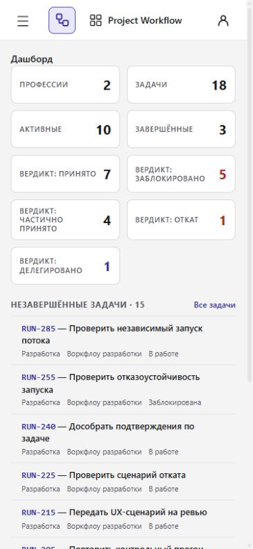
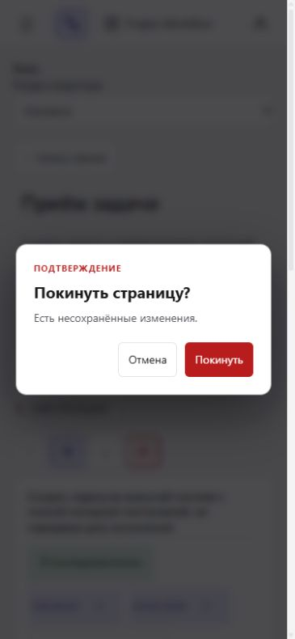

# PDLC и интеграция с Base

## Текущая UI-поставка

UI закреплён на `a6d08995f47353ea049731436bb9ac80b2044fc7` ([pin](../.base-ui-revision)). SDK и skills pins независимы и этим обновлением не меняются. SSR platform-ssr.js и fingerprint обновлены штатным exporter: исходный срок доступа, отзыв приватного DOM, остановка autosave и BFCache. CSS и macros сохранены. React-форма брендинга и offline search входят в UI-пакет, но не добавляются в SSR runtime Workflow.

Датированные разделы ниже описывают историю квалификаций. Текущий pin сам по себе не подтверждает установку или authenticated-приёмку.

Канонические определения находятся у Base: [TERMS](https://github.com/FerrPOINT/services-base/blob/02e1ebbd3d2fcbf1c5e0f55a39d3cf554b085217/docs/platform/TERMS.md),
[ADR 0005](https://github.com/FerrPOINT/services-base/blob/02e1ebbd3d2fcbf1c5e0f55a39d3cf554b085217/docs/adr/0005-pdlc-base-sdlc-terminology.md),
[BRANDING](https://github.com/FerrPOINT/services-base/blob/02e1ebbd3d2fcbf1c5e0f55a39d3cf554b085217/docs/BRANDING.md). Документы продукта ссылаются на эти определения.

## Ответственность продукта

Продукт владеет: определения процессов, профессии и фазы. Запросы, DTO, маршруты, права и предметные правила
остаются здесь. Общие компоненты и механизмы получают данные и callbacks.
SDLC API/scopes/roles/workflow IDs сохраняются как предметные контракты.

## Воспроизводимые зависимости

Dependency-free Python namespace contract экспортируется из Base по новому независимому `.base-revision`; CI проверяет generated-файл. Это не установка HTTP SDK и не изменение skills/catalog pin.

SSR export принадлежит `base-modules/ui/ssr`; продукт хранит штатно экспортированные templates/base и fingerprint. React-примеры справочника не являются SSR macros. `.base-ui-revision` и SDK pin проверяются независимо.

UI SHA хранится в `.base-ui-revision`; SSR tooling и Docker используют
`services-base/base-modules/ui`. React-потребители обновляют также package/lockfiles. Приложения `components-dictionary`
и `base-platform` расположены отдельно и не входят в UI-пакет продукта.
Визуальный каталог запускается только при необходимости проверки примера.

## Переходные контракты

Общий SDK распознаёт оба PAT-префикса и явно доверенную пару JWT audiences.
Проверки issuer, подписи, срока действия и предметных прав сохраняются.
Канонические общеплатформенные env-переменные используют `PDLC_*`; временные
`SDLC_*` aliases не должны конфликтовать. Собственные env-префиксы продукта
сохраняются. Значения credentials не выводятся при диагностике конфликта.

SSO readers поддерживают прежние транзакции. Новые writers включаются
отдельной установкой после принимающих сторон. Опубликованный пользовательский
branding сохраняет приоритет над default PDLC. Исторические ADR, evidence,
миграции и идентификаторы данных не переписываются ради имени платформы.

Локальные source-тесты, hosted CI, установка и authenticated browser-приёмка
фиксируются отдельно. Этот source-комплект не меняет установленный runtime,
credentials или группы `pdlc1`, `pdlc2`, `pdlc3`, `pdlc-common`.

## Локальные доказательства

PostgreSQL integration: 77 тестов прошли на собственном disposable PostgreSQL.
Полный unit/coverage-прогон дал 2542 успешных теста; 16 failures исправлены
в mocks общего SSR global и явном UTF-8 для Node subprocess. Повтор затронутых
модулей и соседних сценариев: 28 passed; итоговый appended coverage 94.17%.
Ruff и mypy (127 файлов) прошли; документационный gate — 13 тестов.
SSR fingerprint и generated Python contract проверены штатными exporters Base.

IAB использовал собственную SQLite smoke-базу с синтетическими данными, без
центральной сессии и внешнего LLM. При ширине 375 проверены dashboard, drawer,
Back/Forward, reload и phase deep link. Неподтверждённый ввод вызывает общий
диалог Base; отмена сохраняет введённое значение, уход после очистки работает.
Это отдельная локальная UI-проверка, не evidence установленного SSO/runtime.

## Source-структура Base

Python SDK расположен в `services-base/base-modules/python/cli-core`; UI и SSR
exporter — в `services-base/base-modules/ui`. Библиотека, Auth, оператор, host и
справочник имеют отдельные границы по
[ADR 0006](https://github.com/FerrPOINT/services-base/blob/a4dea438ec99103ca83b51540d11de548b1ee82d/docs/adr/0006-base-repository-layout.md).
Имена imports, credentials и wire-контракты сохраняются; UI/SDK/skills pins
остаются независимыми. SSR assets получаются штатным exporter и проверяются
по fingerprints. Общие CSS/mechanisms не редактируются в продуктовой копии.
Установка и authenticated межпродуктовая приёмка выполняются отдельно.

## UI-кандидат 2026-10-18

SSR/UI pin: `6f1c797a0b11380f7e36db5ced0360f25a0265a5`.
SDK и skills pins независимы. Обновлены канонические SSR CSS и fingerprint штатным exporter Base: поля формы
получают собственный border-box и не зависят от reset продукта.
Защита черновика и namespace-состояние сохраняют продуктового владельца.
Source-проверки не означают установки в PDLC2.

## Общий каркас Base, source 2026-10-18

UI pin обновлён на `4b80fbfbfae48d95219011a4612dd9427a1a4b92`; SSR CSS и fingerprint
получены штатным exporter Base и проверены на совпадение. Изменение не затрагивает
Workflow state, запросы, Python/SDK/skills pins или installed runtime. React
AppShell не переносится в SSR: здесь сохраняются канонические macros/JS/CSS Base.

## Справочник и общий каркас: 2026-10-18

UI pin `1eb905ffe1d7d983af9464c98e67ee90ead20e18` обновляет подготовленный справочник, проверяемые API-примеры и инструменты проверки Base. Общий CSS ограничивает ширину ProjectPicker и переносит длинные идентификаторы ResourceList; логика React, HTTP API, SDK и skills не меняются. SSR CSS и fingerprint получены штатным exporter. CLI работает offline: `pdlc-ui check` в начале задачи или после смены pin → `search "задача"` → `show ExportName` → один `example`. Полный fingerprint не вычисляется на каждом поиске.

Карточки и демонстрации поддерживаются [приложением Base](https://github.com/FerrPOINT/services-base/tree/main/components-dictionary). Общие каркас, навигация, темы и мобильное меню принадлежат Base; запросы, DTO, права и предметные состояния остаются у продукта. Приёмка source-кандидата не означает установку или production-приёмку.

Workflow остаётся SSR-потребителем. Экспорт и fingerprints канонических macros/JS/CSS проверяются штатным exporter; React AppShell в серверные шаблоны не переносится.
